# Master Plan de Arquitectura Frontend, SEO & Sistema de Diseño UI/UX
## AV SOLUCRET — Plataforma Web de Ingeniería de Superficies Minerales

> **Documento:** `docs/analisis-diseno.md`  
> **Alineación con Sistema de Diseño:** [DESIGN.md](file:///c:/Users/User/Development/KC/avsolucret03/DESIGN.md) (*Luminar Architectural Polish*)  
> **Regla de Negocio Mandatoria (MUST):** **ESTRICTAMENTE CERO PRECIOS PÚBLICOS.** En ninguna sección, paquete, tarjeta o calculadora se mostrarán valores monetarios (S/ o \$). Toda la experiencia se enfoca en rigor técnico, alcance petrográfico, diagnóstico de metraje y conversión a visita técnica in situ.  
> **Filosofía de Arquitectura:** Clean Architecture + Atomic Design + Screaming Architecture. Core Web Vitals óptimos, enrutamiento semántico y SEO técnico local para liderar el sector B2B y residencial premium en Lima Metropolitana.

---

## 1. Menú de Navegación Oficial (6 Opciones)

La arquitectura de información se estructura en exactamente **6 rutas maestras**. Se descarta la opción de "Precios" de la navegación principal (reforzando la regla innegociable de no mostrar tarifas) y se incorpora **TRABAJOS** y **BLOG** como ejes centrales de conversión y autoridad orgánica:

```
┌─────────────────────────────────────────────────────────────────────────────────────────────────┐
│                                   NAVBAR PRINCIPAL (6 OPCIONES)                                 │
├─────────┬──────────┬───────────┬──────────┬──────────┬───────┬─────────────────┬────────────────┤
│ INICIO  │ NOSOTROS │ SERVICIOS │ TRABAJOS │ CONTACTO │ BLOG  │ Tel: 961 801 932│ [Cotizar Ahora]│
└─────────┴──────────┴───────────┴──────────┴──────────┴───────┴─────────────────┴────────────────┘
    │          │           │          │          │        │
    /      /nosotros   /servicios  /trabajos  /contacto  /blog
```

### Matriz de Distribución de Secciones de las 7 Pantallas:
Todas las secciones, módulos interactivos y elementos de las imágenes analizadas se distribuyen orgánicamente entre estas 6 páginas:

| Sección / Módulo del Diseño | Ubicación Principal | Ubicación Secundaria | Función UX & SEO |
| :--- | :--- | :--- | :--- |
| **Hero Asimétrico & Bento Fotográfico** | `INICIO` | — | Impacto inicial y propuesta de valor única |
| **Misión, Visión & Tríada Petrográfica** | `NOSOTROS` | — | Autoridad institucional y filosofía de trabajo |
| **Timeline Histórico (2014 - 2024)** | `NOSOTROS` | — | Trayectoria y solvencia en obras de gran envergadura |
| **Garantías Operacionales (SCTR, LEED, HEPA)** | `NOSOTROS` | `INICIO` (Strip) | Eliminación de objeciones y riesgos para comités |
| **Firma & Colegiatura Ing. Vidal (CIP)** | `NOSOTROS` | `CONTACTO` | Humanización y validación por profesional colegiado |
| **Catálogo de Superficies (4 Frentes)** | `SERVICIOS` | `INICIO` (Grid 2x2) | Detalle de mármol, terrazo, granito y concreto |
| **Slider Interactivo Antes / Después** | `SERVICIOS` | `TRABAJOS` | Demostración visual táctil de reflectometría |
| **Guía de Granulometría (Grits 50 al 3000)** | `SERVICIOS` | — | Justificación técnica de la secuencia abrasiva |
| **Proceso / La Ciencia del Diamante (6 Fases)** | `SERVICIOS` | `INICIO` (Síntesis) | Demostración científica del protocolo de desbaste |
| **Tecnología Klindex/Lavina HEPA Clase M** | `SERVICIOS` | `NOSOTROS` | Respaldo de maquinaria 380V libre de polvo |
| **Producto Destacado: `AV-SHIELD™ ULTRA`** | `INICIO` | `SERVICIOS` | Nanotecnología hidrófuga/oleofóbica exclusiva |
| **Selector Diagnóstico de Superficie** | `SERVICIOS` | `INICIO` | Guía al cliente indeciso según el síntoma del piso |
| **Estimador Técnico de Metraje (CERO PRECIOS)** | `SERVICIOS` | `INICIO` | Lead magnet de cálculo de tiempo y protocolo |
| **Galería de Obras Reales & Fichas Técnicas** | `TRABAJOS` | — | Casos de estudio en San Isidro, Miraflores, Surco |
| **Reseñas & Métricas de Clientes** | `TRABAJOS` | `INICIO` | Prueba social y retención a 12 meses |
| **Google Maps & Cobertura Lima (< 2h)** | `CONTACTO` | `Footer` (Todos) | Zonificación prioritaria y 4 unidades en ruta |
| **Formulario de Prospección In Situ Gratuita** | `CONTACTO` | — | Captura directa de leads cualificados (Ley 29733) |
| **Preguntas Frecuentes (FAQs Acordeón)** | `SERVICIOS` | `INICIO` | Rich snippets SEO y resolución de dudas comunes |
| **Artículos Técnicos & Guías de Cuidado** | `BLOG` | — | Tráfico orgánico masivo y autoridad temática |

---

## 2. Fundamentos del Sistema de Diseño ([DESIGN.md](file:///c:/Users/User/Development/KC/avsolucret03/DESIGN.md) Compliance)

El diseño responde al estándar **Luminar Architectural Polish**:

* **Canvas & Superficies:** Fondo principal `#FFFFFF` con capas en `#F9F9FF`, `#F8F9FA` y `#F2F4F7`.
* **Acentos de Conversión:** Diamond Blue (`#0284C7` / `#006194`) con efectos hover luminosos (`#0EA5E9`).
* **Acentos de Prestigio Editorial:** Bronze / Noble Gold (`#C5A059`, `#B38F48`, fondos `#FCF9F2`).
* **Tipografía:** 
  * Títulos: `Plus Jakarta Sans` (pesos 600, 700, 800; tracking `-0.025em`).
  * Especificaciones y Cuerpo: `Inter` (pesos 400 y 500; interlineado generoso `26px`).
* **Elevación de Precisión:** Bordes milimétricos de `1px` (`#E2E8F0` y `#C5A059` al 15-20%) que simulan el brillo rectificado de la piedra pulida.

---

## 3. Arquitectura Frontend & Estructura del Código

Implementamos **Atomic Design** junto a una separación estricta de lógica y datos:

```text
src/
├── assets/                     # SVGs, logotipos oficiales, esquemas moleculares
├── data/                       # Contratos de datos inmutables tipados (SSOT)
│   ├── company.ts              # Dirección, teléfono, WhatsApp, RUC, CIP, horarios
│   ├── services.ts             # 4 servicios core, paleta de grits (50 a 3000), normas ASTM
│   ├── processes.ts            # Las 6 etapas del protocolo + equipamiento Klindex/Lavina
│   ├── projects.ts             # Galería de obras, distritos, metrajes, antes/después
│   ├── blogPosts.ts            # Metadatos, slugs, autores y contenido de artículos
│   └── faqs.ts                 # Preguntas frecuentes agrupadas por categoría
├── types/                      # Interfaces TypeScript estrictas
│   ├── service.types.ts
│   ├── project.types.ts
│   ├── process.types.ts
│   └── blog.types.ts
├── lib/
│   ├── seo/                    # Inyectores de JSON-LD (LocalBusiness, Service, HowTo, FAQPage)
│   └── utils.ts                # Clases cn, formateadores de texto técnico
├── components/
│   ├── atoms/                  # Badge, Button, MetricPill, StepNumber, GritBadge
│   ├── molecules/              # SectionHeader, AccordionItem, FloatingWhatsApp, EngineerSeal
│   ├── organisms/              # Navbar, Footer, BeforeAfterSlider, ProcessTimeline,
│   │                           # TechnicalEstimator, InteractiveMap, ContactForm, ProjectGrid
│   └── layouts/                # MainLayout (con Navbar y Footer comunes)
└── pages/                      # Las 6 Rutas Oficiales
    ├── Index.tsx               # / (INICIO)
    ├── Nosotros.tsx            # /nosotros (NOSOTROS)
    ├── Servicios.tsx           # /servicios (SERVICIOS)
    ├── Trabajos.tsx            # /trabajos (TRABAJOS / PROYECTOS)
    ├── Contacto.tsx            # /contacto (CONTACTO)
    └── blog/
        ├── BlogIndex.tsx       # /blog (HUB DE ARTÍCULOS)
        ├── CuidadosMarmol.tsx  # /blog/cuidados-marmol
        ├── CuidadosPorcelanato.tsx # /blog/cuidados-porcelanato
        └── CuidadosLajas.tsx   # /blog/cuidados-lajas
```

---

## 4. Desglose Exhaustivo de las 6 Páginas

---

### 1️⃣ PÁGINA: INICIO (`/`)
*Misión:* Presentación institucional de alto estándar, credibilidad técnica inmediata y conversión multicanal.

* **Top Utility Bar:** Mención a normas ASTM acreditadas y garantía institucional.
* **Navbar Oficial:** Los 6 enlaces principales + Teléfono directo + Botón *"Cotizar Ahora"*.
* **Hero Asimétrico (Grid 7:5):**
  * Columna izquierda: Badge editorial dorado, H1 con palabras clave (*"EXPERTOS EN **PULIDO DIAMANTADO** EN LIMA, PERÚ"*), CTAs duales (WhatsApp prioritario + enlace a Trabajos) y micro-confianza (*Visita in situ gratuita*, *100% libre de polvo*).
  * Columna derecha: Bento fotográfico (Pisos Carrara Brillo Espejo, reflectometría 98%, concreto arquitectónico).
* **Barra de Métricas de Alto Impacto (4 KPIs):**
  * `500+` Proyectos en Lima • `10+` Años de Liderazgo • `100%` Garantía Técnica • `Cobertura Total` (San Isidro, Miraflores, Surco a Asia).
* **Sistemas Abrasivos Graduales (Grid 2x2):**
  * Mármol y Granito, Terrazo Veneciano, Concreto Pulido con Densificador de Litio, Mantenimiento Termoquímico.
* **Síntesis del Protocolo de 6 Fases:**
  * Vista condensada del flujo de diamantado invitando a profundizar en `/servicios`.
* **Producto Destacado: Sellador Nanométrico `AV-SHIELD™ ULTRA`:**
  * Ilustración hexagonal de red molecular, ficha de beneficios impermeables y oleofóbicos, y botón para solicitar aplicación.
* **Estimador Técnico de Metraje (Lead Magnet sin precios):**
  * Slider de área en $m^2$, selector de superficie y cálculo instantáneo del protocolo recomendado y tiempo de obra, con botón a WhatsApp.
* **Banner de Conversión Pre-Footer:**
  * Llamado directo a coordinar inspección con ingenieros de campo.
* **Footer Institucional:**
  * Información corporativa, RUC, enlaces de navegación, distritos atendidos en Lima y marca de agua `AV SOLUCRET`.

---

### 2️⃣ PÁGINA: NOSOTROS (`/nosotros`)
*Misión:* Construir una barrera de confianza inexpugnable para comités residenciales, empresas y arquitectos.

* **Hero Editorial:**
  * Eyebrow en ámbar: *"NUESTRA HISTORIA & FILOSOFÍA TÉCNICA"*.
  * H1: *"EXCELENCIA EN CADA SUPERFICIE"*.
  * Cita de honor enmarcada con borde dorado sobre la transformación de la materia mineral y densificadores de litio.
* **Trayectoria Evolutiva (Bento 2 Columnas):**
  * Columna izquierda: Foto en obra de técnicos con maquinaria planetaria y panel de 3 métricas (`0% Polvo`, `3000 m²/mes`, `12+ Años`).
  * Columna derecha: Timeline vertical con hitos (2014 fundación en San Isidro/Miraflores, 2018 salas limpias HEPA, +150,000 m² intervenidos, 2024 liderazgo corporativo).
* **Misión & Visión Corporativa (Bloques 01 y 02):**
  * Compromisos de durabilidad a 50 años y cumplimiento de la norma ASTM C779.
  * Tríada metodológica: *01. Diagnóstico Petrográfico* → *02. Secuencia Gradual Pro* → *03. Sellado Hídro-Óleo Fugante*.
* **Garantías Operacionales en Obra (Grid de 4 Tarjetas):**
  * *Protocolo Cero Polvo (HEPA M)*: Aire filtrado sin manchas en muros recién pintados.
  * *Seguro SCTR al Día*: Cobertura completa para personal técnico apto para plantas y faenas.
  * *Garantía Escrita 5 Años*: Certificado formal contra desprendimiento o pérdida súbita de brillo.
  * *Química Certificada LEED®*: Fórmulas base agua y VOC ultra-bajo.
* **Especialidad por Tipología de Sustrato:**
  * Diferenciación de tratamientos para mármoles cálcicos, granitos silíceos y matrices de cemento.
* **Firma y Respaldo CIP:**
  * Sello y firma del **Ing. Alejandro Vidal — Gerente Técnico AV SOLUCRET — Colegiado CIP Reg. 184652**.

---

### 3️⃣ PÁGINA: SERVICIOS (`/servicios`)
*Misión:* Exponer la oferta técnica en profundidad, resolver objeciones y guiar al usuario en la elección del tratamiento correcto.

* **Hero con Filtros Interactivos:**
  * Selector por píldoras: *Todos*, *Mármol y Granito*, *Terrazo Veneciano*, *Concreto Pulido*, *Cristalizado & Mantenimiento*.
  * Insignia destacada: *100% Libre de Polvo*.
* **Showcase Detallado de los 4 Servicios:**
  * **01. Mármol y Granito:** Incluye el **Slider Interactivo Antes / Después** y la barra de granulometría (pads desde grano 50 hasta 3000).
  * **02. Terrazo Veneciano:** Restauración artesanal, curado de juntas y micro-poros.
  * **03. Concreto Pulido & Superflat:** Enfoque logístico/industrial con métricas de resistencia y ahorro del -70% en mantenimiento.
  * **04. Cristalizado Periódico:** Mantenimiento termoquímico preventivo para hoteles y banca.
* **El Protocolo de 6 Fases (La Ciencia del Diamante):**
  * Timeline alternado en zigzag (Mohs, desbaste, epóxico, diamantes resinados, densificado y control con glossmetro).
  * Ficha de equipamiento industrial Klindex y Lavina con aspiración ciclónica clase M.
* **Selector Diagnóstico: "¿Qué Tratamiento Requiere su Superficie?":**
  * 4 fichas interactivas: Desbastado, Pulido Diamantado, Cristalizado o Sellador Hidrófugo.
* **Acordeón de Preguntas Frecuentes (FAQs Técnicas):**
  * 5 preguntas críticas con respuestas directas (polvo, muebles, tiempos de secado, garantías).
* **Ficha de Asesor Técnico:**
  * Atención directa de ingeniería con tiempo de respuesta estimado < 15 minutos.

---

### 4️⃣ PÁGINA: TRABAJOS (`/trabajos`)
*Misión:* Mostrar la evidencia visual irrefutable de obras reales ejecutadas en Lima Metropolitana y provincias.

* **Hero de Proyectos:**
  * H1: *"PORTAFOLIO DE OBRAS & RESTAURACIONES DE ALTO ESTÁNDAR"*.
  * Selector de proyectos por categoría: *Todos*, *Residencial Premium*, *Corporativo & Retail*, *Industrial & Logística*, *Patrimonio Histórico*.
* **Grid de Casos de Estudio Reales:**
  * Cada proyecto incluye:
    * Nombre de la obra y ubicación (ej. *Penthouse San Isidro*, *Lobby Hotel Miraflores*, *Almacén Lurín*).
    * Metraje intervenido ($m^2$).
    * Sustrato mineral y estado inicial.
    * Grits aplicados y lectura final en Gloss Units (ej. *92 GU*).
    * Selector interactivo de fotografías Antes / Después.
* **Muro de Reseñas y Recomendaciones:**
  * Testimonios verificados de arquitectos, administradores de edificios residenciales y jefes de planta industrial.
* **CTA de Validación:**
  * *"¿Tiene un proyecto con especificaciones complejas? Solicite una muestra técnica in situ sin costo"*.

---

### 5️⃣ PÁGINA: CONTACTO (`/contacto`)
*Misión:* Máxima fluidez de conversión, transparencia geográfica y agendamiento de inspección técnica.

* **Hero de Contacto Inmediato:**
  * Línea Directa de Ingeniería: `961 801 932` con botón verde WhatsApp 24/7.
* **Formulario Técnico de Prospección In Situ (100% Gratuito):**
  * Campos: Nombre / Empresa, Teléfono, Selector de mineral (Mármol, Terrazo, Granito, Concreto), Distrito de Lima y Metraje aproximado ($m^2$).
  * Cumplimiento estricto con la Ley N° 29733 de Protección de Datos Personales del Perú.
* **Mapa Interactivo de Cobertura de Lima:**
  * Delimitación gráfica del **Anillo Prioritario (< 2 Horas)**: San Isidro, Miraflores, Surco, San Borja, La Molina, Barranco, Magdalena.
  * Zona Metropolitana: Callao, Lurín, Ate, San Miguel, Lima Norte.
  * Marcador de Sede Central: *AV SOLUCRET LAB — Surquillo, Lima*.
  * Monitor de unidades en ruta: *4 Equipos móviles activos con maquinaria HTC y filtros HEPA*.
* **Pilares de Respuesta Rápida:**
  * `< 15 Minutos` de respuesta, `Norma ASTM C779`, `Garantía Escrita`.

---

### 6️⃣ PÁGINA: BLOG (`/blog`)
*Misión:* Captura masiva de tráfico orgánico no de marca, educación al cliente y autoridad técnica petrográfica.

* **Hub de Artículos (`/blog`):**
  * Buscador interno y filtros temáticos: *Mármol*, *Terrazo*, *Porcelanato*, *Lajas*, *Concreto*, *Mantenimiento y Normas*.
  * Artículo destacado con banner de lectura técnica de 5 minutos.
  * Grid de posts con autoría del equipo de ingeniería, fecha, tiempo de lectura y tags.
* **Artículos Base Existentes e Integrados:**
  * `/blog/cuidados-marmol` — Guía definitiva para evitar el ataque ácido y preservar el brillo cristalino.
  * `/blog/cuidados-porcelanato` — Limpieza profunda y remoción de manchas de obra sin dañar el esmalte.
  * `/blog/cuidados-lajas` — Sellado hidrofóbico y tratamiento contra la eflorescencia salina en piedras exteriores.
* **Estructura Interna de Cada Post:**
  * H1 optimizado para long-tail SEO.
  * Tabla de contenidos flotante (Jump to section).
  * Diagramas explicativos, tablas de pH de limpiadores y advertencias técnicas sobre el uso de ceras caseras.
  * Banner lateral fijo: *"¿Tus pisos ya perdieron el brillo original? Solicita diagnóstico in situ sin costo"*.

---

## 5. Estrategia SEO Técnico & Microdatos Schema.org

| Página | Ruta | Schema.org Primario | Keywords Principales Objetivo |
| :--- | :--- | :--- | :--- |
| **Inicio** | `/` | `LocalBusiness` / `HomeAndConstructionBusiness` | pulido de pisos lima, pulido diamantado peru, restauracion de pisos san isidro |
| **Nosotros** | `/nosotros` | `AboutPage` + `Person` (Ing. Vidal) | empresa de pulido de pisos lima, especialistas en marmol sctr hepa |
| **Servicios** | `/servicios` | `Service` + `HowTo` + `FAQPage` | pulido de marmol lima, restauracion terrazo veneciano, concreto pulido litio |
| **Trabajos** | `/trabajos` | `CollectionPage` + `ImageGallery` | fotos pulido de pisos antes y despues lima, obras restauracion marmol miraflores |
| **Contacto** | `/contacto` | `ContactPage` | cotizar pulido de pisos lima, visita tecnica gratuita pulido pisos surco |
| **Blog** | `/blog/*` | `BlogPosting` + `Article` | como cuidar piso de marmol, como limpiar terrazo manchado, sellador de piedras |

---

## 6. Hoja de Ruta de Implementación Pantalla por Pantalla

Iremos implementando el sistema de forma incremental, verificando calidad visual, responsive y semántica en cada paso:

```mermaid
flowchart LR
    P0["0. Cimientos de Datos & Types"] --> P1["1. Navbar & Footer Globales"]
    P1 --> P2["2. Pantalla: INICIO"]
    P2 --> P3["3. Pantalla: NOSOTROS"]
    P3 --> P4["4. Pantalla: SERVICIOS"]
    P4 --> P5["5. Pantalla: TRABAJOS"]
    P5 --> P6["6. Pantalla: CONTACTO"]
    P6 --> P7["7. Pantalla: BLOG"]
    P7 --> P8["8. Auditoría SEO & Core Web Vitals"]
```



¡Arquitectura definida, datos organizados y reglas de negocio blindadas!
